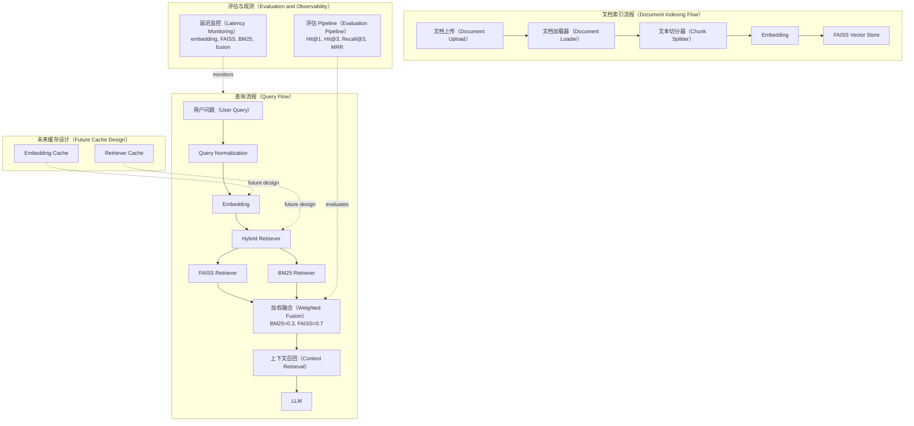

# AI RAG 检索增强生成项目（Retrieval Augmented Generation）

AI RAG 是一个面向知识库问答场景的 Retrieval Augmented Generation 项目，覆盖文档上传、文本切分、Embedding、FAISS 向量检索、BM25 关键词检索、Hybrid Retriever 融合排序，以及 LLM 生成回答等核心流程。

## RAG 检索优化 Pipeline（RAG Optimization Pipeline）

### 1. 检索评估基线（Baseline Evaluation）

项目使用 `eval/evaluation.json` 建立检索评估基线。每条评估样本包含：

- `query`
- `expected_filename`
- `expected_chunk_id`

评估重点放在 LLM 生成之前的检索质量，核心指标包括：

- `Hit@1`：期望 chunk 是否排在第 1 位。
- `Hit@3`：期望 chunk 是否出现在 Top 3。
- `Recall@3`：Top 3 召回能力。
- `MRR`：期望 chunk 的 Mean Reciprocal Rank。

Baseline 结果：

| Metric | Value |
| --- | ---: |
| Hit@1 | 20% |
| Recall@3 | 1.0 |
| MRR | 0.6 |

基线实验结果表明当前系统召回能力正常（`Recall@3=1.0`），主要问题集中在检索结果排序阶段。

### 2. 检索归因分析（Retrieval Attribution）

Retrieval Attribution 将 Hybrid Retriever 拆解为三个独立视角进行分析：

- FAISS semantic retriever
- BM25 keyword retriever
- `EnsembleRetriever`

针对 query：

```text
公司名称是什么？
```

归因结果如下：

| Retriever | Top Result |
| --- | --- |
| FAISS | `chunk_id=0 rank1` |
| BM25 | `chunk_id=1 rank1` |
| Ensemble | `chunk_id=1 rank1` |

Root Cause：

FAISS 能够正确将 `chunk_id=0` 排在第 1 位，但 BM25 将 `chunk_id=1` 错排到第 1 位，最终 `EnsembleRetriever` 在融合排序时继承了 BM25 的误排结果。

### 3. Hybrid Retriever 权重优化（Hybrid Retriever Optimization）

Hybrid Retriever 通过 BM25 与 FAISS 的 weighted fusion 生成最终检索排序。本阶段实验对 BM25/FAISS 权重进行了对比：

- `0.5 / 0.5`
- `0.3 / 0.7`
- `0.2 / 0.8`

实验结果：

| Config | Hit@1 | MRR | Recall@3 |
| --- | ---: | ---: | ---: |
| BM25=0.5, FAISS=0.5 | 0.2 | 0.6 | 1.0 |
| BM25=0.3, FAISS=0.7 | 0.9 | 0.95 | 1.0 |

推荐实验配置：

```text
BM25=0.3
FAISS=0.7
```

该配置在保留 Hybrid Retriever 结构的前提下，降低了 BM25 误排对最终排序的影响，使 `Hit@1` 从 `0.2` 提升到 `0.9`，`MRR` 从 `0.6` 提升到 `0.95`。

### 4. 检索延迟分析（Retrieval Latency Profiling）

Latency Profiling 将 retriever invoke 路径拆解为 Embedding、FAISS search、BM25 search 和 fusion 等阶段。

平均延迟结果：

| Stage | Average Latency |
| --- | ---: |
| Embedding API | 109.8ms |
| FAISS search | 0.1ms |
| BM25 search | 0.5ms |

分析结论：

当前主要性能瓶颈来自 query Embedding API 调用。对于当前测试知识库，FAISS、BM25 与 fusion 的本地计算耗时较低。

### 5. Embedding Cache 实验验证（Embedding Cache Experiment）

Embedding Cache 实验模拟同一个 query 连续请求 10 次：

```text
公司名称是什么？
```

实验结果：

| Scenario | Average Latency |
| --- | ---: |
| Baseline | 106.9ms |
| Cache enabled experiment | 9.5ms |

收益验证：

- Latency reduction: 91.12%
- API call reduction: 90%

该实验仅验证 Embedding Cache 的优化收益，当前项目未实现生产级缓存系统。Embedding Cache 与 Retriever Cache 均属于未来生产优化方向（Future Design），并不表示已经接入 Redis 或已上线缓存能力。

## 项目架构（Architecture）



架构说明：

- 文档上传后经过 Document Loader、Chunk Splitter 和 Embedding，最终写入 FAISS Vector Store。
- Query Flow 同时使用 FAISS semantic retriever 与 BM25 keyword retriever。
- Weighted Fusion 是当前 Hybrid Retriever 的核心优化点，实验推荐配置为 `BM25=0.3, FAISS=0.7`。
- Embedding Cache 与 Retriever Cache 在图中以 Future Design 形式展示，仅代表未来生产优化方向，不表示当前已经实现。
- Evaluation Pipeline 与 Latency Monitoring 用于持续跟踪检索质量和运行时性能。

## 工程亮点（Engineering Highlights）

- 建立 RAG 检索评估体系：通过 `evaluation.json` 与 `Hit@1`、`Hit@3`、`Recall@3`、`MRR` 指标，将检索质量从主观判断转为可量化评估。
- 使用 Retrieval Attribution 定位 Hybrid Retriever 排序问题：拆解 FAISS、BM25 与 `EnsembleRetriever` 的独立排序结果，确认 BM25 误排是关键原因。
- 通过权重实验优化 `EnsembleRetriever`：将 Hybrid Retriever 权重从 `BM25=0.5, FAISS=0.5` 调整为 `BM25=0.3, FAISS=0.7`，使 `Hit@1` 从 `0.2` 提升到 `0.9`，`MRR` 从 `0.6` 提升到 `0.95`。
- 完成 Latency Profiling 定位 Embedding API 瓶颈：确认当前主要延迟来自 Embedding API，而不是 FAISS、BM25 或 fusion 本地计算。
- 验证 Embedding Cache 优化收益：重复 query 实验显示 `Latency reduction: 91.12%`，`API call reduction: 90%`，为后续生产优化提供依据。
